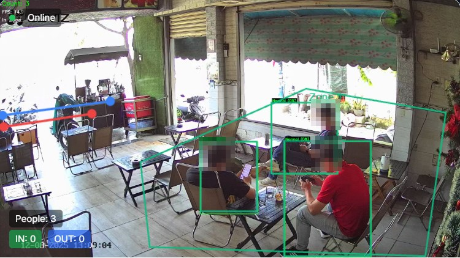
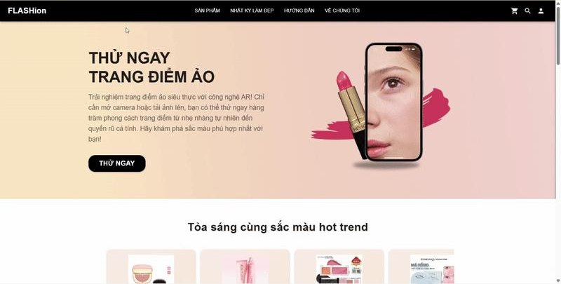
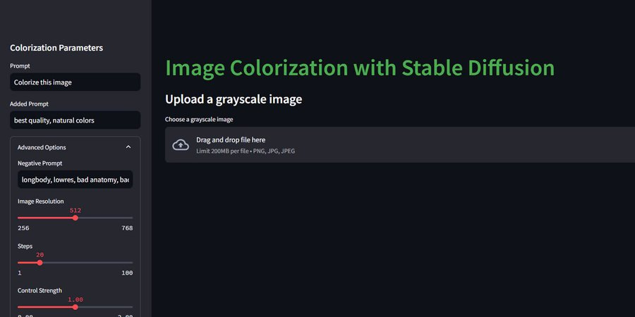

<h1 align="center">Mai Anh Quan</h1>

  <b>AI Engineer · Computer Vision & Video Analytics · Python, FastAPI</b> 
  Ho Chi Minh City, Vietnam (UTC+7) · Open to freelance projects and full-time roles

  
  
  

I build AI systems end to end: model integration, backend, frontend, and deployment with Docker.
I like turning a business problem into a working product.
I have led small teams on both product and research projects.

## Featured projects

<table>
  <tr>
    <td width="45%" valign="top">
      
    </td>
    <td valign="top">
      <h3><a href="https://github.com/kiokpam/AIPS">AIPS</a> · AI store monitoring</h3>
      Multi-camera store analytics: people counting, zone-based behavior alerts, and Telegram/email notifications, running on-prem on one consumer GPU.  
      <i>Project Lead (graduation project, team of 4). I built most of the FastAPI backend and Next.js frontend, the service that connects the CV models to the app, the notification service, the Docker setup, and the tests.</i>  
      <code>FastAPI</code> <code>Next.js</code> <code>YOLOv8</code> <code>DeepSORT</code> <code>ONNX Runtime</code> <code>PostgreSQL</code> <code>Docker</code>
    </td>
  </tr>
  <tr>
    <td width="45%" valign="top">
      
    </td>
    <td valign="top">
      <h3><a href="https://github.com/Qcymaq/Flashion">Flashion</a> · Beauty e-commerce</h3>
      Beauty e-commerce web app with membership tiers, an admin dashboard, and photo-based virtual makeup try-on (MediaPipe FaceMesh).  
      <i>Main developer on a team project; also did the market research and user surveys.</i>  
      <code>FastAPI</code> <code>MongoDB</code> <code>React</code> <code>TypeScript</code> <code>MediaPipe</code> <code>Docker</code>
    </td>
  </tr>
  <tr>
    <td width="45%" valign="top">
      
    </td>
    <td valign="top">
      <h3><a href="https://github.com/Qcymaq/Colorization-for-grayscale-images">Colorize</a> · Photo colorization</h3>
      Black-and-white photo colorization with ControlNet + Stable Diffusion, with a FastAPI inference endpoint and a Streamlit UI.  
      <i>Team lead. I wrote the data preparation, the inference API, the Streamlit UI, and the model cache.</i>  
      <code>Stable Diffusion</code> <code>ControlNet</code> <code>PyTorch</code> <code>FastAPI</code> <code>Streamlit</code>
    </td>
  </tr>
  <tr>
    <td colspan="2" valign="top">
      <h3><a href="https://github.com/Qcymaq/PCRNN-CRNN-VNTM-MGC">Vietnamese traditional music genre classification</a> · Research</h3>
      Audio models that classify Vietnamese traditional music by genre.  
      <i>Team research (team of 7). ICCRI 2024 paper on CRNN/PCRNN models (corresponding author; I wrote the CRNN/PCRNN notebooks). Related JCSSE 2024 IEEE paper comparing DenseNet models (3rd author; <a href="https://github.com/Bui-Tung-Hung/LateFusionCNN-DenseNet121-VNTM-MGC">code</a>).</i>  
      
      
      
    </td>
  </tr>
</table>

## What I can build for you

- Integrating computer-vision models into a working video-analytics app (people counting, zone alerts) on your existing cameras, running on-prem
- A web app around your AI prototype (FastAPI, Next.js/React, WebSockets, Docker)
- Web apps with AI features and an admin dashboard
- Photo colorization with diffusion models (ControlNet + Stable Diffusion)
- Audio classification models (CRNN/PCRNN)

## Tech I have used in real projects

- **Languages**:   
- **Backend and web**:    
- **Databases**:  
- **AI / ML**:       
- **Data and BI**: 
- **Tools**:     -47A141?style=flat-square&logo=overleaf&logoColor=white)

## Experience

- **Pythera AI** – AI Intern & Sub-team Leader (09/2024 – 02/2025). Volunteered to lead a 3-person research sub-team on color restoration of low-light photos; wrote step-by-step onboarding SOPs in Notion.
- **Cinnamon AI Bootcamp 2024** – Trainee (06/2024 – 08/2024). Worked on team projects; wrote the CLIP image-encoding module of a team image-search project.

## Education

- **B.Sc. in Artificial Intelligence**, FPT University Ho Chi Minh City (2022 – 2026)

## Languages

Vietnamese (native) · English · German (learning)

## Contact

[quanmaianh.work@gmail.com](mailto:quanmaianh.work@gmail.com) · [LinkedIn](https://www.linkedin.com/in/maq159) · [All repositories](https://github.com/Qcymaq?tab=repositories)
